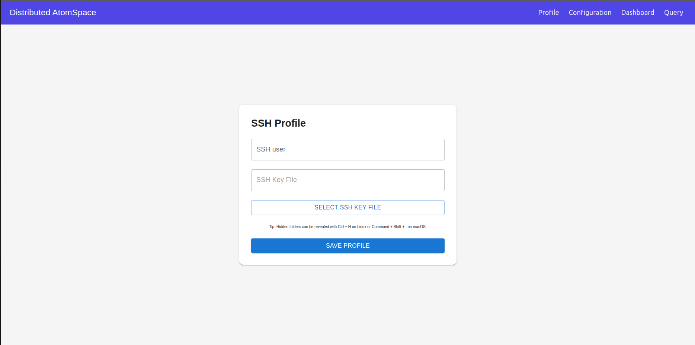
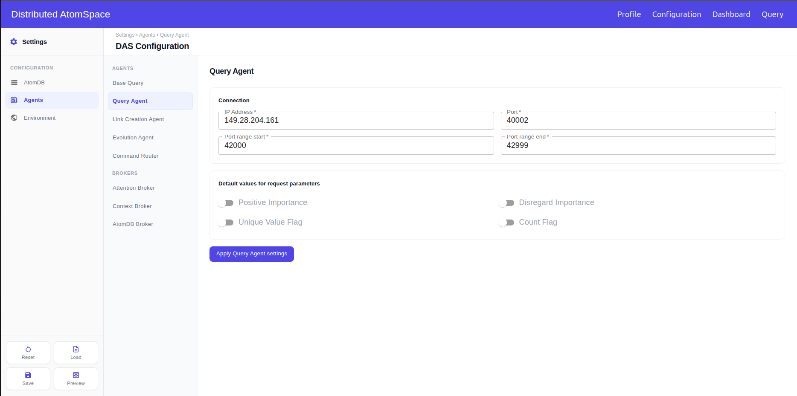
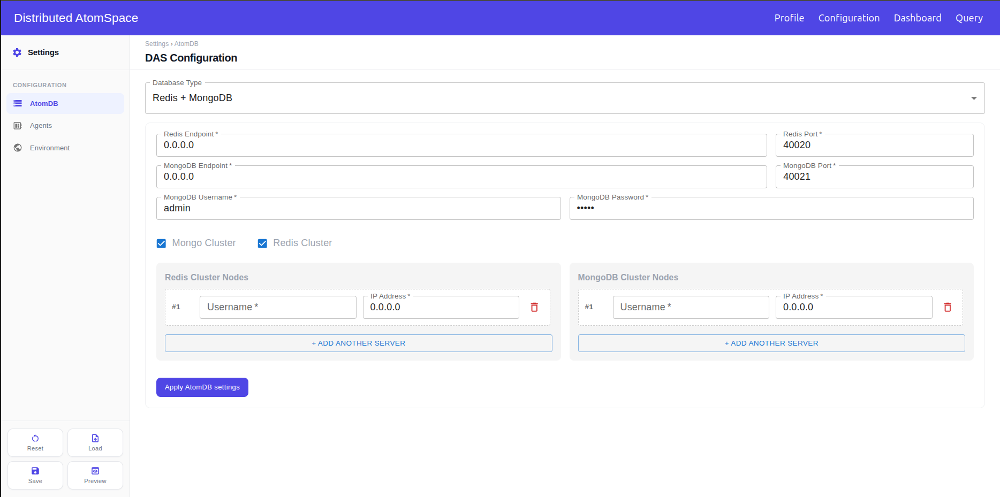
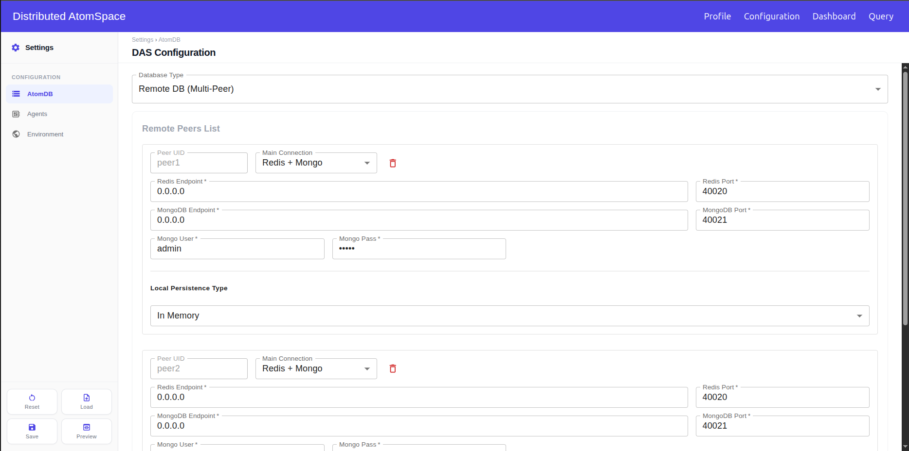
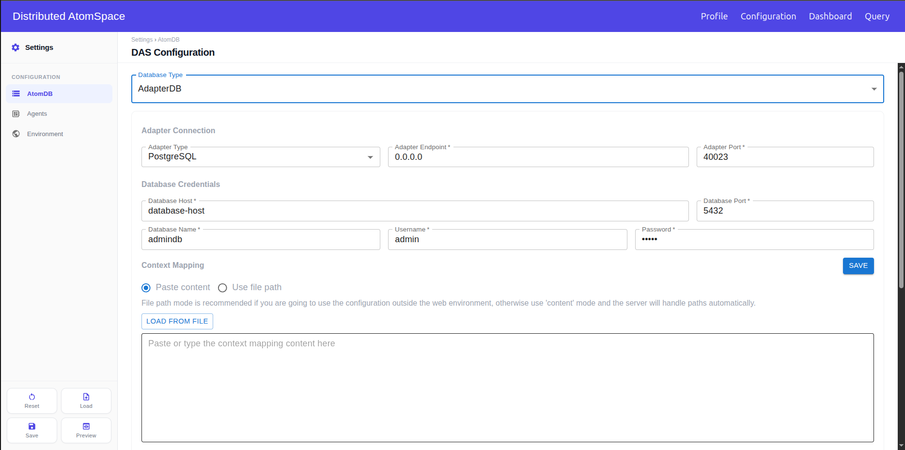
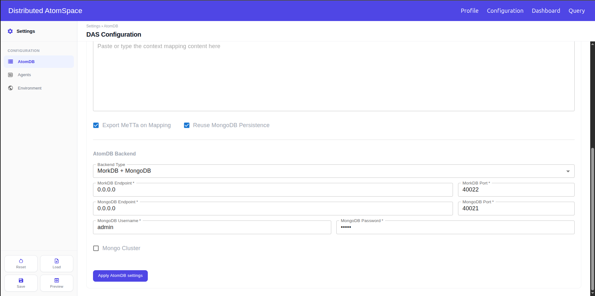
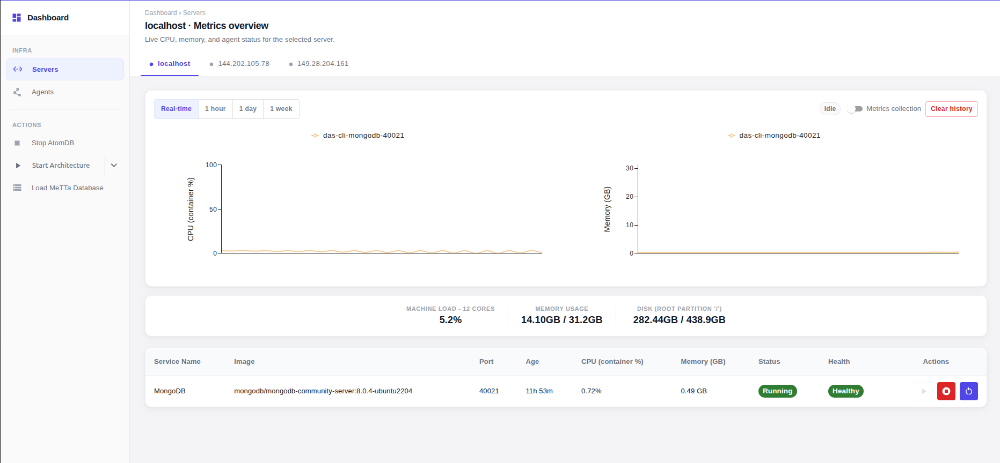
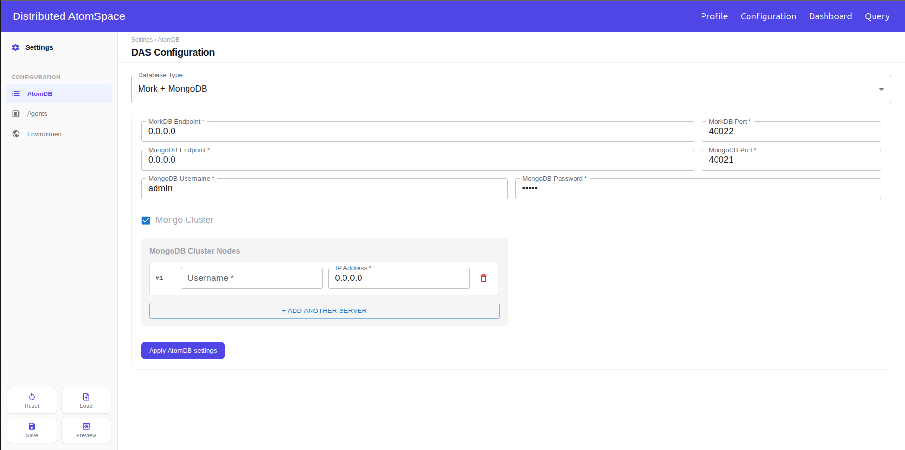
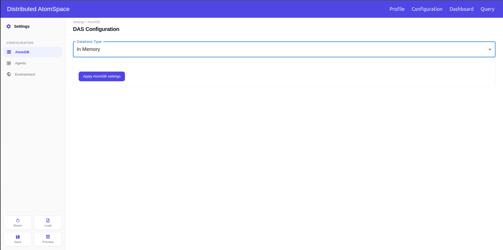
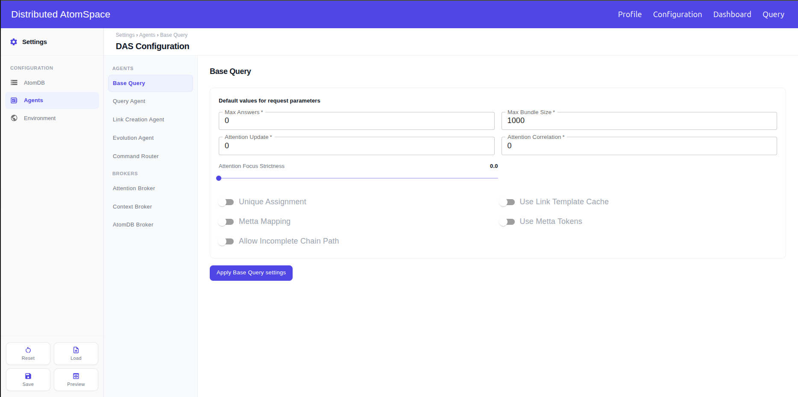

# DAS Dashboard

The Distributed Atomspace Dashboard is a web interface for configuring, operating, and monitoring a DAS environment. It is, basically, a wrapper around [das-cli](../das-cli/README.md): every start, stop, configuration, and query action runs `das-cli` underneath.

## Table of Contents

* [Screens](#screens)
* [Prerequisites](#prerequisites)
* [SSH access](#ssh-access)
* [Starting the interface](#starting-the-interface)
* [Using the dashboard](#using-the-dashboard)
  * [1. Profile](#1-profile)
  * [2. Configuration](#2-configuration)
    * [Keeping the defaults](#keeping-the-defaults)
    * [Changing a few values](#changing-a-few-values)
    * [Running the DAS on more than one machine](#running-the-das-on-more-than-one-machine)
    * [Running Redis or MongoDB as a cluster](#running-redis-or-mongodb-as-a-cluster)
    * [Using another AtomDB](#using-another-atomdb)
    * [Loading a configuration you already have](#loading-a-configuration-you-already-have)
    * [Checking before you save](#checking-before-you-save)
    * [Starting over](#starting-over)
  * [3. Dashboard](#3-dashboard)
    * [Starting the DAS](#starting-the-das)
    * [Loading a MeTTa file into the AtomDB](#loading-a-metta-file-into-the-atomdb)
    * [Watching one service](#watching-one-service)
    * [Keeping a metrics history](#keeping-a-metrics-history)
    * [Seeing the whole architecture](#seeing-the-whole-architecture)
    * [Stopping the DAS](#stopping-the-das)
  * [4. Query](#4-query)
  * [5. Common errors & troubleshooting](#5-common-errors--troubleshooting)
* [Reference](#reference)
  * [Profile page](#profile-page)
  * [Configuration page](#configuration-page)
    * [Page actions](#page-actions)
    * [Addresses](#addresses)
    * [AtomDB section](#atomdb-section)
    * [Agents section](#agents-section)
    * [Environment section](#environment-section)
  * [Dashboard page](#dashboard-page)
    * [Actions](#actions)
    * [Servers view](#servers-view)
    * [Agents view](#agents-view)

## Screens

The top bar has four pages.

| Page | Path | What it is for |
|---|---|---|
| Profile | `/profiles` | SSH username and private key used for every remote operation |
| Configuration | `/configuration` | AtomDB, agents, brokers, and their parameters |
| Dashboard | `/dashboard` | Machines discovered from the saved configuration, service status, and runtime metrics |
| Query | `/query` | Compose and run a query, then inspect the answers |

## Prerequisites

Install **das-cli** before starting the dashboard. The same version must be installed on the machine that runs the dashboard and on every machine that will take part in the architecture.

The dashboard container uses the binary at `/usr/bin/das-cli`. Install with the APT repository or a local `.deb` package, as described in the [das-cli installation](../das-cli/README.md#installation). A `pip install` inside a virtualenv does not put the binary on that path.

Docker must be installed on the dashboard machine and on every machine where `das-cli` will start a container. The SSH user configured below must be allowed to use Docker on each of those machines (typically by being in the `docker` group).

## SSH access

The Profile page stores one username and one private key. The dashboard uses that key for SCP, remote `das-cli` commands, and the Docker contexts that start databases on other machines. The matching **public** key has to be in `authorized_keys` for that user on every machine in the architecture.

Create a key pair on the machine where you will open the dashboard:

```bash
ssh-keygen -t ed25519 -f ~/.ssh/das-dashboard -N ""
```

`~/.ssh/das-dashboard` is the private key you will upload on the **Profile** page. `~/.ssh/das-dashboard.pub` is the public key.

On each machine, log in as the same username you will type on the Profile page. That account must not be `root`. See [Profile](#1-profile).

```bash
mkdir -p ~/.ssh
chmod 700 ~/.ssh
cat >> ~/.ssh/authorized_keys
# paste the contents of das-dashboard.pub, then press Ctrl-D
chmod 600 ~/.ssh/authorized_keys
```

Confirm the key works before using the dashboard:

```bash
ssh -i ~/.ssh/das-dashboard <username>@<host> das-cli --version
```

## Starting the interface

From `das-dashboard/`:

```bash
./scripts/start_interface.sh
```

The script builds the frontend and backend images and starts both containers on the host network.

| Service | URL |
|---|---|
| Dashboard | http://localhost:5173 |
| Backend | http://localhost:8000 |
| Backend API docs | http://localhost:8000/docs |

Override the ports with the following variables: `FRONT_PORT` and `BACK_PORT`.
Example: `FRONT_PORT=4000 BACK_PORT=5000 ./scripts/start_interface.sh`

## Using the dashboard

A first run goes in this order: save your SSH profile, save a configuration, start the DAS on the Dashboard page, and run queries on the Query page.

If the whole DAS runs on this machine with the default values, skip Profile. Open Configuration and click **Save**.

### 1. Profile



Do this first when the DAS will use more than one machine. The dashboard reaches every other machine with this user and key.

1. Create the key pair and authorize it on every machine, as described in [SSH access](#ssh-access).
2. Open **Profile** and type the SSH user. It cannot be `root`.
3. Click **Select SSH Key File** and pick the private key, the file without `.pub`.
4. Click **Save Profile**.

When you come back to change something, select the key again: the page keeps the username but not the key. If a later step fails with an authentication error, the public key is not authorized for that user on that machine.

### 2. Configuration

This page sets up the DAS environment and its agents. Changing anything here is optional: with the default values, one **Save** is enough.

The sidebar splits the configuration into **AtomDB**, **Agents**, and **Environment**. Every change follows the same steps: change the fields, click **Apply … settings** at the bottom of that section, then click **Save**. Apply alone stores nothing, and Save only stores what was applied.

#### Keeping the defaults

If the default values are enough, click **Save**. The defaults put the whole DAS on this machine. The dashboard stores the configuration and sets it as the current DAS configuration. If the file names another machine, Save also copies it there and runs `das-cli config set` on that machine. That copy needs the SSH user and key from [Profile](#1-profile).

After a successful save, the page asks **Save a local copy?**. Downloading that copy is optional. **Not now** leaves the file on the server at `/opt/web-das/.das/config.json`.

#### Changing a few parameters and values

To change a port, an ip address or a parameter in general:

1. Open the section in the sidebar. For an agent, open **Agents** and pick it from the list.
2. Change the fields specified on the sub-section.
3. Click **Apply … settings**. The page confirms that the settings were applied.
4. Repeat for any other section you want to change.
5. Click **Save**.

If you move to another section without clicking Apply, the edits you made there are not in the file.

#### Running the DAS on more than one machine

The addresses on this page are not only where the dashboard starts each part. The DAS reads them back, and that is how its parts find each other. The Link Creation Agent, the Evolution Agent, and the Context Broker look for the Query Agent at its address. The agents look for the Attention Broker at its address. The members of a database cluster reach each other at theirs.

So type addresses with that in mind. The default `0.0.0.0` only works when everything is on one machine. For anything that runs on another machine, type the IP the other machines use to reach it.



1. Save your [Profile](#1-profile), and authorize the key on every machine.
2. Decide which machine runs each part, and note the IP each machine is reached at.
3. Open **AtomDB** and type the IP of the database machine in the endpoint fields. Click **Apply AtomDB settings**.
4. Open **Agents**. For each agent on another machine, type that machine's IP and click **Apply**. Do the Query Agent and the Attention Broker first: the other agents look for them.
5. Click **Save**. The dashboard copies the file to every machine named in it and makes it the active configuration there. The confirmation lists the machines it reached.

Then open the Dashboard page to start each part on its machine.

#### Running Redis or MongoDB as a cluster

Cluster mode is optional. Use it when Redis or MongoDB should run on several machines and work as one database.



1. Save your [Profile](#1-profile). Every member of the cluster is started over SSH with it.
2. Open **AtomDB** and choose **Redis + MongoDB**. Mork + MongoDB works too, but only MongoDB can be a cluster there.
3. Check **Redis Cluster**, **Mongo Cluster**, or both.
4. In the list that opens, fill one row per machine: the IP of the machine that will run that member, and the username saved in Profile. Click **+ Add Another Server** for each extra machine. das-cli expects at least three members.
5. Make sure the port above the list is free on all of those machines. Every member listens on it.
6. Click **Apply AtomDB settings**, then **Save**.

When the AtomDB is started, das-cli connects to each row over SSH, starts the database there, and joins the members into one cluster. The machines need to reach each other on that port.

#### Using another AtomDB

A DAS uses one AtomDB type. Redis + MongoDB is the default. To use another one, choose it in **Database Type**, fill it in, and click **Apply AtomDB settings**. The new type replaces the old one. Then click **Save**.

**Mork + MongoDB.** Same steps as Redis + MongoDB, with MorkDB in place of Redis.

**In Memory.** Nothing to fill in and no database to start. Choose it, apply, and save. The atoms live only in memory, so they are gone when the process stops.

**Remote DB.** A set of peers, each with its own database. The dashboard will start the databases at the specified IP addresses if necessary.



1. Click **+ Add Peer** once for each peer.
2. For each peer, choose the **Main Connection** and fill its addresses and ports.
3. Choose the **Local Persistence Type** for each peer. In Memory needs nothing else.
4. Click **Apply AtomDB settings**. A peer with an empty port is left out.

**AdapterDB.** Maps an external PostgreSQL database into atoms. In here you have to set-up both the DB that will be used to load the atoms, and the AtomDB that will persist the atoms.



1. Under **Adapter Connection**, set where the adapter will listen.
2. Under **Database Credentials**, type the PostgreSQL database to map.
3. Under **Context Mapping**, keep **Paste content**. Paste the mapping, or click **Load from file** and pick the `.sql` file. Click the **Save** next to Context Mapping.
4. Scroll down to **AtomDB Backend** and choose where the mapped atoms will be stored. Fill it in the same way as that AtomDB type.
5. Click **Apply AtomDB settings**, then **Save**.



Choose **Use file path** in step 3 only if the configuration will also be used outside the dashboard. Then type the path of the mapping file instead.

#### Loading a configuration you already have

1. Click **Load** and pick the `.json` file.
2. Confirm. The file replaces the configuration on this dashboard, and the form shows its values.
3. To change something, edit the section, click **Apply**, then **Save**.

Load only changes this dashboard. If the file names other machines, click **Save** after loading to copy it to them.

#### Checking before you save

Click **Preview** to see what Save will store. If a change you made is missing, go back to that section and click **Apply**.

#### Starting over

Click **Reset** and confirm. Every section goes back to the DAS defaults, and what you typed is lost. The file already saved stays as it is until you click **Save** again.

### 3. Dashboard

This is where you start the DAS and watch it run. The page reads the saved configuration and connects to every machine named in it.



It has two views, picked in the sidebar. **Servers** shows one machine at a time, and the tabs at the top switch between machines. `localhost` is this machine. **Agents** shows every service on every machine at once. The actions under the views start and load the DAS.

If the page says **No servers configured**, save a configuration first. See [Keeping the defaults](#keeping-the-defaults).

#### Starting the DAS

The AtomDB comes first: the agents need it to run.

1. In **Servers**, select the tab of the machine that hosts the AtomDB. When everything runs on this machine, that is `localhost`.
2. Click **Start AtomDB** and confirm. Anything of the AtomDB already running there is restarted, and its data is lost.
3. Wait until the button reads **Stop AtomDB**. **Start Architecture** stays disabled until then.
4. To start only some services, click the arrow next to **Start Architecture** and uncheck the ones you don't need. Leave **Core** checked: the Attention Broker and the Query Agent are what the other agents connect to.
5. Click **Start Architecture** and confirm the list. Each service starts on the machine set for it in Configuration.
6. Check the table on each server tab. A started service shows **Running**.

#### Loading a MeTTa file into the AtomDB

1. In **Servers**, select the tab of the machine that hosts the AtomDB.
2. Click **Load MeTTa Database** and pick the file. Only `.metta` files are accepted.
3. Wait for the confirmation. The file is copied to that machine, or kept on the dashboard for `localhost`, and loaded into the AtomDB.

If a file with that name was already sent, the page asks what to do. **OK** replaces it with the new one. **Cancel** loads the file already there.

#### Watching one service

In the table under the charts, click the service. The CPU and memory charts now show only that service. Click it again to go back to all of them.

To start, stop, or restart that one service, use the buttons at the end of its row.

#### Keeping a metrics history

The charts open in **Real-time**, which needs nothing else. To look back over an hour, a day, or a week, the dashboard has to record samples first.

1. Select the server tab.
2. Turn on **Metrics collection**. The chip next to it changes from **Idle** to **Collecting**.
3. Later, pick **1 hour**, **1 day**, or **1 week** above the charts.

Collection keeps running for that server while the dashboard is up, even with the page closed. Turn it off with the same switch. **Clear history** deletes what was recorded.

#### Seeing the whole architecture

Click **Agents** in the sidebar. Every service on every machine appears as a card, with the agents and the AtomDB on separate tabs. Click a card to open its live CPU and memory charts.

#### Stopping the DAS

1. Click the arrow next to **Stop Architecture** if you want to keep some services running, and uncheck them.
2. Click **Stop Architecture** and confirm.
3. Select the AtomDB machine's tab, click **Stop AtomDB**, and confirm. The data in the AtomDB is lost.

### 4. Query

Query runs a query from the browser and shows the result as it arrives. The query can be written in MeTTa or in the default syntax. The page updates live, including charts for answer importance and for how many answers arrive per second.

Query parameters are edited on the same page: answer limits and the other parameters of the query.

**Pre-requisites:** The page needs a running architecture with at least an Attention Broker, a Query Agent, and a Command Router, and a database that already has data loaded.

### 5. Common errors & troubleshooting

## Reference

### Profile page

Path: `/profiles`.

| Control | What it does |
|---|---|
| SSH user | Account used on every machine. The same account that owns the `authorized_keys` entry and can run Docker and `das-cli`. |
| SSH Key File | Name of the private key chosen for this save. Stays empty until a file is selected. A key saved earlier is not shown again. |
| Select SSH Key File | Opens the file picker. Hidden folders can be revealed with Ctrl+H on Linux, or Command+Shift+. on macOS. |
| Save Profile | Stores the username and the private key. Both are required. |

Rules:

* `root` is rejected. Root is refused for security, and das-cli blocks operations run as that user.
* The username needs at least 3 characters. Allowed characters are letters, digits, `.`, `_`, and `-`.
* Saving always asks for the key file again. Reopening the page restores only the username.

Messages:

| Message | Cause |
|---|---|
| Profile saved successfully. | Username and key were stored. |
| SSH Username must have at least 3 characters and cannot contain invalid characters. | The username is shorter than 3 characters, contains another character, or is `root`. |
| SSH Key File is required. | No key file was selected. |

### Configuration page

Path: `/configuration`.

#### Page actions

| Button | What it does |
|---|---|
| Apply … settings | At the bottom of each section. Puts that section's fields into the configuration that Save will store. Shows **… settings applied**. |
| Save | Stores the applied sections at `/opt/web-das/.das/config.json` and activates it with `das-cli config set`. Copies the file over SSH to every other machine named in it and activates it there. Then offers a local copy. |
| Load | Opens a `.json` file. After confirmation, the file must have `atomdb` and `agents`. It becomes the active configuration on this dashboard and fills the form. It is not copied to other machines. |
| Preview | Shows the applied values of each section. Values not yet applied are not shown. Read only. |
| Reset | Asks for confirmation, then fills every section with the DAS defaults. The saved file is not changed until the next Save. |

#### Addresses

* `localhost`, `127.0.0.1`, and `0.0.0.0` mean this machine. Any other address is treated as another machine, and Save copies the file to it.
* The Link Creation Agent, Evolution Agent, and Context Broker read the Query Agent endpoint to connect to it.
* The services on the DAS bus read the Attention Broker endpoint.
* Each cluster row is reached as `username@ip` over SSH. A Docker context is created for it.
* A cluster row with an empty username, `root`, or `default` is saved with the Profile username.

#### AtomDB section

**Database Type**

| Option | Value in the file | What `das-cli db start` brings up |
|---|---|---|
| Redis + MongoDB | `redismongodb` | Redis and MongoDB |
| Mork + MongoDB | `morkdb` | MorkDB and MongoDB |
| In Memory | `inmemorydb` | Nothing |
| Remote DB (Multi-Peer) | `remotedb` | Nothing. The peers' databases must already be running. |
| AdapterDB | `adapterdb` | The databases of the AtomDB Backend chosen. The mapping runs with `das-cli database-adapter run`. |

**Redis + MongoDB**

| Field | Default | Notes |
|---|---|---|
| Redis Endpoint | `0.0.0.0` | |
| Redis Port | `40020` | Also the port of every Redis cluster member. |
| MongoDB Endpoint | `0.0.0.0` | |
| MongoDB Port | `40021` | Also the port of every MongoDB cluster member. |
| MongoDB Username | `admin` | |
| MongoDB Password | `admin` | |
| Mongo Cluster | Off | Opens **MongoDB Cluster Nodes**. |
| Redis Cluster | Off | Opens **Redis Cluster Nodes**. |

Each cluster list has one row per member, with **Username** and **IP Address**. **+ Add Another Server** adds a row, and the trash icon removes it. A cluster turned on with no rows is rejected on Save.

**Mork + MongoDB**



| Field | Default | Notes |
|---|---|---|
| MorkDB Endpoint | `0.0.0.0` | |
| MorkDB Port | `40022` | |
| MongoDB fields | As in Redis + MongoDB | Including **Mongo Cluster**. MorkDB has no cluster option. |

**In Memory**



No fields.

**Remote DB (Multi-Peer)**

| Field | Default | Notes |
|---|---|---|
| + Add Peer | | Adds a peer. The list starts empty. |
| Peer UID | `peer1`, `peer2`, … | Assigned by the form. Read only. |
| Main Connection | Redis + Mongo | Or Mork + Mongo. Opens the endpoint, port, Mongo User, and Mongo Pass fields. No cluster option. |
| Local Persistence Type | In Memory | Or Redis + MongoDB, or MorkDB + MongoDB, which open the same connection fields. |
| Trash icon | | Removes the peer. |

A peer with an empty port is dropped when you apply.

**AdapterDB**

| Field | Default | Notes |
|---|---|---|
| Adapter Type | PostgreSQL | The only option. |
| Adapter Endpoint | `0.0.0.0` | Where the adapter listens. |
| Adapter Port | `40023` | |
| Database Host | `database-host` | The PostgreSQL server to map. |
| Database Port | `5432` | |
| Database Name | `admindb` | |
| Username | `admin` | |
| Password | `admin` | |
| Paste content / Use file path | Paste content | How the context mapping is given. |
| Load from file | | Paste content mode. Reads a `.sql` file into the box. |
| Context Mapping File Path | | Use file path mode. Path of the mapping file. |
| MeTTa Output Path | | Use file path mode. Where the MeTTa files are written. |
| Save (Context Mapping) | | Stores the mapping. In Paste content mode, the server picks the file path. |
| Export MeTTa on Mapping | On | Writes MeTTa files when the mapping runs. |
| Reuse MongoDB Persistence | On | Keeps the adapter's existing MongoDB. |
| Backend Type | MorkDB + MongoDB | Or In Memory, or Redis + MongoDB. Opens the fields of that type, including its cluster options. |

#### Agents section

Every agent except Base Query has **IP Address** and **Port**: where it listens, and where the others look for it. Most also have **Port range start** and **Port range end**, the ports its workers may use. All IPs default to `0.0.0.0`.

| Agent | Started with | Port | Port range |
|---|---|---|---|
| Base Query | Not started. Shared query defaults. | | |
| Query Agent | `das-cli query-agent start` | `40002` | `42000`–`42999` |
| Link Creation Agent | `das-cli link-creation-agent start` | `40003` | `43000`–`43999` |
| Evolution Agent | `das-cli evolution-agent start` | `40005` | `45000`–`45999` |
| Command Router | `das-cli command-router start` | `40008` | `48000`–`48999` |
| Attention Broker | `das-cli attention-broker start` | `40001` | None |
| Context Broker | `das-cli context-broker start` | `40006` | `46000`–`46999` |
| AtomDB Broker | `das-cli atomdb-broker start` | `40007` | `47000`–`47999` |

The Command Router also has **HTTP API endpoint**, read only and the same host as its IP, and **HTTP API port**, default `40009`.

Parameters are stored under `agents.<agent>.params` in the file.

**Base Query**



| Field | Key | Default |
|---|---|---|
| Max Answers | `max_answers` | `0` |
| Max Bundle Size | `max_bundle_size` | `1000` |
| Attention Update | `attention_update` | `0` |
| Attention Correlation | `attention_correlation` | `0` |
| Attention Focus Strictness | `attention_focus_strictness` | `0.0`. Slider from 0 to 1, in steps of 0.1. |
| Unique Assignment | `unique_assignment_flag` | Off |
| Use Link Template Cache | `use_link_template_cache` | Off |
| Metta Mapping | `populate_metta_mapping` | Off |
| Use Metta Tokens | `use_metta_as_query_tokens` | Off |
| Allow Incomplete Chain Path | `allow_incomplete_chain_path` | Off |

**Query Agent**

| Field | Key | Default |
|---|---|---|
| Positive Importance | `positive_importance_flag` | Off |
| Disregard Importance | `disregard_importance_flag` | Off |
| Unique Value Flag | `unique_value_flag` | Off |
| Count Flag | `count_flag` | Off |

**Link Creation Agent**

| Field | Key | Default |
|---|---|---|
| Max Answers | `max_answers` | `10` |
| Repeat Count | `repeat_count` | `1` |
| Context | `context` | `context` |
| Attention Update | `attention_update` | `0` |
| Attention Correlation | `attention_correlation` | `0` |
| Query Interval | `query_interval` | `0` |
| Query Timeout | `query_timeout` | `0` |
| Positive Importance | `positive_importance_flag` | On |
| Use MeTTa as Query Tokens | `use_metta_as_query_tokens` | Off |

**Evolution Agent**

| Field | Key | Default |
|---|---|---|
| Population Size | `population_size` | `1000` |
| Max Generations | `max_generations` | `100` |
| Elitism Rate | `elitism_rate` | `0.01` |
| Selection Rate | `selection_rate` | `0.1` |

**Context Broker**

| Field | Key | Default |
|---|---|---|
| Context Name | `context` | `context` |
| Initial Rent Rate | `initial_rent_rate` | `0.75` |
| Spread Lowerbound | `initial_spreading_rate_lowerbound` | `0.1` |
| Spread Upperbound | `initial_spreading_rate_upperbound` | `0.1` |
| Use Cache | `use_cache` | On |
| Force Cache Reset | `enforce_cache_recreation` | Off |

The Command Router, Attention Broker, and AtomDB Broker have no parameters.

#### Environment section

| Field | Default | Notes |
|---|---|---|
| Jupyter Notebook Port | `40019` | Port of the notebook started with `das-cli jupyter-notebook start`. The host stays as saved, `0.0.0.0` by default. |

### Dashboard page

Path: `/dashboard`.

The sidebar has two groups. **Infra** switches between the [Servers view](#servers-view) and the [Agents view](#agents-view). **Actions** has the three [actions](#actions). Servers is the view that opens first.

The server tabs list every machine named in the saved configuration. `localhost` comes first when any part of the DAS is on this machine, followed by the other IPs.

| Header | When |
|---|---|
| **No servers configured** | No configuration has been saved. |
| **Connection failed** | The selected server could not be reached. The reason is shown below the title. |
| **`<server>` · Metrics overview** | Servers view. |
| **Architecture overview** | Agents view. |

#### Actions

| Action | What it does |
|---|---|
| Start AtomDB | Runs `das-cli db start` on the server selected in the tabs, over SSH for a remote server. The confirmation names the AtomDB type and the server. Any AtomDB component already running there is restarted, and its data is lost. |
| Stop AtomDB | Shown in place of Start AtomDB while the AtomDB is online. Runs `das-cli db stop` on the selected server. All its components stop, and their data is lost. |
| Start Architecture | Starts the services checked in the selector, each on the machine set for it in the configuration. Disabled until the AtomDB is online. The confirmation lists the services. |
| Stop Architecture | Shown in place of Start Architecture while the architecture is online. Stops the services checked in the selector, in reverse order. |
| Arrow next to Start/Stop Architecture | Opens the service selector. |
| Load MeTTa Database | Opens a file picker for `.metta` files. Sends the file to the selected server and runs `das-cli metta load` there. For `localhost`, the file is kept on the dashboard. |

All actions are disabled while another action is running, or while the selected server is offline or still connecting. After a start or stop, the page checks every server again to update the buttons.

**Service selector.** Every service is checked when the page opens.

| Group | Service | Start order |
|---|---|---|
| Core | Attention Broker | 1 |
| Core | Query Agent | 2 |
| Agents | AtomDB Broker | 3 |
| Agents | Command Router | 4 |
| Agents | Context Broker | 5 |
| Agents | Link Creation Agent | 6 |
| Agents | Evolution Agent | 7 |

Core services are the ones the other agents connect to. Unchecking them can leave the architecture unusable. A checked service with no host in the configuration is skipped.

**Load MeTTa Database, file already on the server.** The file is kept under `~/.das/workspace/metta_files` on that machine, or `/opt/web-das/.das/workspace/metta_files` on the dashboard. If a file with the same name is there, the page asks: **OK** overwrites it and loads the new file, **Cancel** loads the existing one.

Messages:

| Message | Cause |
|---|---|
| AtomDB must be online before starting architecture. | Start Architecture was used with no AtomDB online. |
| Select at least one service to start. | Every service in the selector is unchecked. |
| Select at least one service to stop. | Same, with the architecture online. |
| MeTTa database loaded successfully. | The file was sent and loaded. |
| MeTTa file overwritten and loaded successfully. | **OK** was chosen for a file already on the server. |
| Existing MeTTa file loaded successfully. | **Cancel** was chosen for a file already on the server. |

#### Servers view

From top to bottom: the chart toolbar, the CPU and memory charts, the machine summary, and the services table.

**Chart toolbar**

| Control | What it does |
|---|---|
| Real-time | Live samples from the selected server. Default. |
| 1 hour, 1 day, 1 week | Stored samples for that period, averaged into 30 points. Empty until Metrics collection has recorded something. |
| Idle / Collecting | Whether Metrics collection is running for this server. |
| Metrics collection | Starts or stops recording samples for this server. Recording continues in the dashboard backend with the page closed. Only servers in the configuration can be recorded. |
| Clear history | Opens a menu. **This server** deletes this server's samples. **Unused servers** deletes samples of servers no longer in the configuration. **All servers** deletes every sample. Each asks for confirmation. |

**Charts.** CPU (container %) and memory (GB) for every service on the server. With a service selected in the table, only that one.

**Machine summary**

| Field | What it shows |
|---|---|
| Machine Load – *N* cores | CPU usage of the whole machine. |
| Memory Usage | Used and total RAM, in GB. |
| Disk (Root partition '/') | Used and total space, in GB. |

**Services table.** One row per service on the selected server.

| Column | What it shows |
|---|---|
| Service Name | The service. |
| Image | Docker image. |
| Port | Port it listens on. |
| Age | Time since it started. |
| CPU (container %) | CPU usage of its container. |
| Memory (GB) | Memory of its container. |
| Status | Running, Offline, or another container state, shown in red. |
| Health | Healthy or Unhealthy, from the container health check. **Running** when the container has no check. |
| Actions | Start, enabled while stopped. Stop and Restart, enabled while running. Each runs on the machine set for that service in the configuration. |

Clicking a row selects it and filters the charts. Clicking it again clears the selection.

#### Agents view

Two tabs, **Agents** and **AtomDB**, split the services by type. Each card is one service on one machine.

| Card field | What it shows |
|---|---|
| Name, server IP, container | Which service, and where. |
| Status | Running, or Offline. |
| CPU, Memory | Current usage, as bars. |
| Port, Image, Uptime | As in the services table. |
| Health | Healthy, Unhealthy, Running when there is no health check, or No status when offline. |

Clicking a card opens **CPU Usage In-Time** and **Memory Usage In-Time** for that service, below the cards. These charts are live only. Switching tabs closes them.
