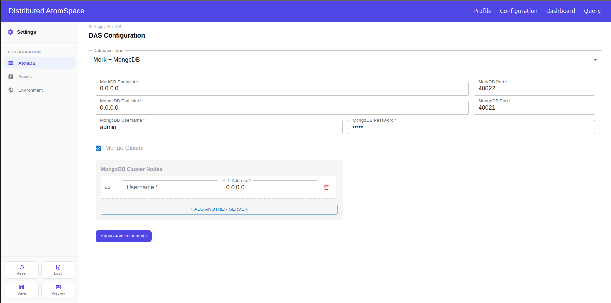
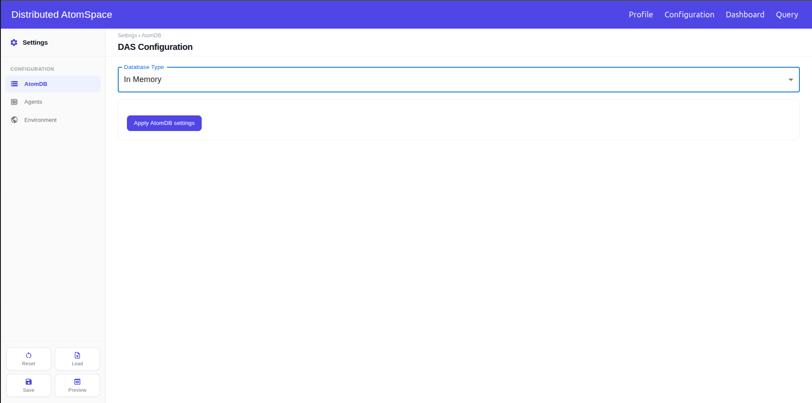
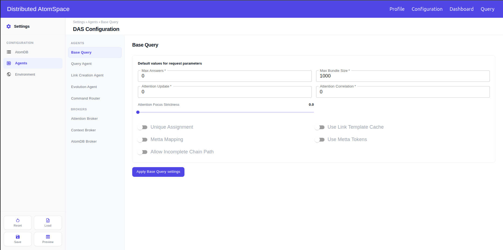

# Reference

Every page of the dashboard: its fields, buttons, default values, and messages. For step-by-step use, see [Using the dashboard](using-the-dashboard.md).

## Contents

* [Screens](#screens)
* [Profile page](#profile-page)
* [Configuration page](#configuration-page)
  * [Page actions](#page-actions)
  * [Addresses](#addresses)
  * [AtomDB section](#atomdb-section)
  * [Agents section](#agents-section)
  * [Environment section](#environment-section)
* [Dashboard page](#dashboard-page)
  * [Actions](#actions)
  * [Servers view](#servers-view)
  * [Agents view](#agents-view)
* [Query page](#query-page)
  * [Query box](#query-box)
  * [Parameters](#parameters)
  * [Status bar](#status-bar)
  * [Results](#results)
  * [Charts](#charts)
  * [Messages](#messages)

## Screens

The top bar has four pages.

| Page | Path | What it is for |
|---|---|---|
| Profile | `/profiles` | SSH username and private key used for every remote operation |
| Configuration | `/configuration` | AtomDB, agents, brokers, and their parameters |
| Dashboard | `/dashboard` | Machines discovered from the saved configuration, service status, and runtime metrics |
| Query | `/query` | Compose and run a query, then inspect the answers |

## Profile page

Path: `/profiles`.

| Control | What it does |
|---|---|
| SSH user | Account used on every machine. The same account that owns the `authorized_keys` entry and can run Docker and `das-cli`. |
| SSH Key File | Name of the private key chosen for this save. Stays empty until a file is selected. A key saved earlier is not shown again. |
| Select SSH Key File | Opens the file picker. Hidden folders can be revealed with Ctrl+H on Linux, or Command+Shift+. on macOS. |
| Save Profile | Stores the username and the private key. Both are required. |

Rules:

* `root` is rejected. Root is refused for security, and das-cli blocks operations run as that user.
* The username needs at least 3 characters. Allowed characters are letters, digits, `.`, `_`, and `-`.
* Saving always asks for the key file again. Reopening the page restores only the username.

Messages:

| Message | Cause |
|---|---|
| Profile saved successfully. | Username and key were stored. |
| SSH Username must have at least 3 characters and cannot contain invalid characters. | The username is shorter than 3 characters, contains another character, or is `root`. |
| SSH Key File is required. | No key file was selected. |

## Configuration page

Path: `/configuration`.

### Page actions

| Button | What it does |
|---|---|
| Apply … settings | At the bottom of each section. Puts that section's fields into the configuration that Save will store. Shows **… settings applied**. |
| Save | Stores the applied sections at `/opt/web-das/.das/config.json` and activates it with `das-cli config set`. Copies the file over SSH to every other machine named in it and activates it there. Then offers a local copy. |
| Load | Opens a `.json` file. After confirmation, the file must have `atomdb` and `agents`. It becomes the active configuration on this dashboard and fills the form. It is not copied to other machines. |
| Preview | Shows the applied values of each section. Values not yet applied are not shown. Read only. |
| Reset | Asks for confirmation, then fills every section with the DAS defaults. The saved file is not changed until the next Save. |

### Addresses

* `localhost`, `127.0.0.1`, and `0.0.0.0` mean this machine. Any other address is treated as another machine, and Save copies the file to it.
* The Link Creation Agent, Evolution Agent, and Context Broker read the Query Agent endpoint to connect to it.
* The services on the DAS bus read the Attention Broker endpoint.
* Each cluster row is reached as `username@ip` over SSH. A Docker context is created for it.
* A cluster row with an empty username, `root`, or `default` is saved with the Profile username.

### AtomDB section

**Database Type**

| Option | Value in the file | What `das-cli db start` brings up |
|---|---|---|
| Redis + MongoDB | `redismongodb` | Redis and MongoDB |
| Mork + MongoDB | `morkdb` | MorkDB and MongoDB |
| In Memory | `inmemorydb` | Nothing |
| Remote DB (Multi-Peer) | `remotedb` | `das-cli db start` starts Redis and MongoDB for each peer whose main connection is Redis + Mongo. A Mork peer is not started. |
| AdapterDB | `adapterdb` | The databases of the AtomDB Backend chosen. The mapping runs with `das-cli database-adapter run`. |

**Redis + MongoDB**

| Field | Default | Notes |
|---|---|---|
| Redis Endpoint | `0.0.0.0` | |
| Redis Port | `40020` | Also the port of every Redis cluster member. |
| MongoDB Endpoint | `0.0.0.0` | |
| MongoDB Port | `40021` | Also the port of every MongoDB cluster member. |
| MongoDB Username | `admin` | |
| MongoDB Password | `admin` | |
| Mongo Cluster | Off | Opens **MongoDB Cluster Nodes**. |
| Redis Cluster | Off | Opens **Redis Cluster Nodes**. |

Each cluster list has one row per member, with **Username** and **IP Address**. **+ Add Another Server** adds a row, and the trash icon removes it. A cluster turned on with no rows is rejected on Save.

**Mork + MongoDB**

| Field | Default | Notes |
|---|---|---|
| MorkDB Endpoint | `0.0.0.0` | |
| MorkDB Port | `40022` | |
| MongoDB fields | As in Redis + MongoDB | Including **Mongo Cluster**. MorkDB has no cluster option. |

**In Memory**

No fields.

**Remote DB (Multi-Peer)**

| Field | Default | Notes |
|---|---|---|
| + Add Peer | | Adds a peer. The form opens with the template peers `peer1` and `peer2`. Remove any peer you do not need before applying. |
| Peer UID | `peer1`, `peer2`, … | Assigned by the form. Read only. |
| Main Connection | Redis + Mongo | Or Mork + Mongo. Opens the endpoint, port, Mongo User, and Mongo Pass fields. No cluster option. |
| Local Persistence Type | In Memory | Or Redis + MongoDB, or MorkDB + MongoDB, which open the same connection fields. |
| Trash icon | | Removes the peer. |

A peer with an empty port is dropped when you apply.

**AdapterDB**

| Field | Default | Notes |
|---|---|---|
| Adapter Type | PostgreSQL | The only option. |
| Adapter Endpoint | `0.0.0.0` | Where the adapter listens. |
| Adapter Port | `40023` | |
| Database Host | `database-host` | The PostgreSQL server to map. |
| Database Port | `5432` | |
| Database Name | `admindb` | |
| Username | `admin` | |
| Password | `admin` | |
| Paste content / Use file path | Paste content | How the context mapping is given. |
| Load from file | | Paste content mode. Reads a `.sql` file into the box. |
| Context Mapping File Path | | Use file path mode. Path of the mapping file. |
| MeTTa Output Path | | Use file path mode. Where the MeTTa files are written. |
| Save (Context Mapping) | | Stores the mapping. In Paste content mode, the server picks the file path. |
| Export MeTTa on Mapping | On | Writes MeTTa files when the mapping runs. |
| Reuse MongoDB Persistence | On | Keeps the adapter's existing MongoDB. |
| Backend Type | MorkDB + MongoDB | Or In Memory, or Redis + MongoDB. Opens the fields of that type, including its cluster options. |

### Agents section

Every agent except Base Query has **IP Address** and **Port**: where it listens, and where the others look for it. Most also have **Port range start** and **Port range end**, the ports its workers may use. All IPs default to `0.0.0.0`.

| Agent | Started with | Port | Port range |
|---|---|---|---|
| Base Query | Not started. Shared query defaults. | | |
| Query Agent | `das-cli query-agent start` | `40002` | `42000`–`42999` |
| Link Creation Agent | `das-cli link-creation-agent start` | `40003` | `43000`–`43999` |
| Evolution Agent | `das-cli evolution-agent start` | `40005` | `45000`–`45999` |
| Command Router | `das-cli command-router start` | `40008` | `48000`–`48999` |
| Attention Broker | `das-cli attention-broker start` | `40001` | None |
| Context Broker | `das-cli context-broker start` | `40006` | `46000`–`46999` |
| AtomDB Broker | `das-cli atomdb-broker start` | `40007` | `47000`–`47999` |

The Command Router also has **HTTP API endpoint**, read only and the same host as its IP, and **HTTP API port**, default `40009`.

Parameters are stored under `agents.<agent>.params` in the file.

**Base Query**

| Field | Key | Default |
|---|---|---|
| Max Answers | `max_answers` | `0` |
| Max Bundle Size | `max_bundle_size` | `1000` |
| Attention Update | `attention_update` | `0` |
| Attention Correlation | `attention_correlation` | `0` |
| Attention Focus Strictness | `attention_focus_strictness` | `0.0`. Slider from 0 to 1, in steps of 0.1. |
| Unique Assignment | `unique_assignment_flag` | Off |
| Metta Mapping | `populate_metta_mapping` | Off |
| Use Metta Tokens | `use_metta_as_query_tokens` | Off |
| Allow Incomplete Chain Path | `allow_incomplete_chain_path` | Off |

**Query Agent**

| Field | Key | Default |
|---|---|---|
| Positive Importance | `positive_importance_flag` | Off |
| Disregard Importance | `disregard_importance_flag` | Off |
| Unique Value Flag | `unique_value_flag` | Off |
| Count Flag | `count_flag` | Off |

**Link Creation Agent**

| Field | Key | Default |
|---|---|---|
| Unique Assignment | `unique_assignment_flag` | Off |
| Positive Importance | `positive_importance_flag` | Off |
| Disregard Importance | `disregard_importance_flag` | Off |
| Unique Value | `unique_value_flag` | Off |
| Max Successful Creation per Round | `max_successful_creation_per_round` | `10` |
| Max Unproductive Visits per Round | `max_unproductive_visits_per_round` | `500` |
| Max Visit Attempts per Round | `max_visit_attempts_per_round` | `20` |
| Max Rounds | `max_rounds` | `5` |
| Link Creation Strength Threshold | `link_creation_strength_threshold` | `0.1` |

**Evolution Agent**

| Field | Key | Default |
|---|---|---|
| Population Size | `population_size` | `1000` |
| Max Generations | `max_generations` | `100` |
| Elitism Rate | `elitism_rate` | `0.01` |
| Selection Rate | `selection_rate` | `0.1` |

**Context Broker**

| Field | Key | Default |
|---|---|---|
| Context Name | `context` | `context` |
| Initial Rent Rate | `initial_rent_rate` | `0.75` |
| Spread Lowerbound | `initial_spreading_rate_lowerbound` | `0.1` |
| Spread Upperbound | `initial_spreading_rate_upperbound` | `0.1` |
| Use Cache | `use_cache` | On |
| Force Cache Reset | `enforce_cache_recreation` | Off |

The Command Router, Attention Broker, and AtomDB Broker have no parameters.

### Environment section

| Field | Default | Notes |
|---|---|---|
| Jupyter Notebook Port | `40019` | Port of the notebook started with `das-cli jupyter-notebook start`. The host stays as saved, `0.0.0.0` by default. |

## Dashboard page

Path: `/dashboard`.

The sidebar has two groups. **Infra** switches between the [Servers view](#servers-view) and the [Agents view](#agents-view). **Actions** has the three [actions](#actions). Servers is the view that opens first.

The server tabs list every machine named in the saved configuration. `localhost` comes first when any part of the DAS is on this machine, followed by the other IPs.

| Header | When |
|---|---|
| **No servers configured** | No configuration has been saved. |
| **Connection failed** | The selected server could not be reached. The reason is shown below the title. |
| **`<server>` · Metrics overview** | Servers view. |
| **Architecture overview** | Agents view. |

### Actions

| Action | What it does |
|---|---|
| Start AtomDB | Runs `das-cli db start` on the server selected in the tabs. Select that server first. The confirmation names the AtomDB type and the server. Redis, MongoDB, and MorkDB containers already running there are kept. |
| Stop AtomDB | Shown in place of Start AtomDB while the AtomDB is online. Runs `das-cli db stop` on the server selected in the tabs. All its components stop, and their data is lost. |
| Start Architecture | Starts the services checked in the selector, each on the machine set for it in the configuration. Disabled until the AtomDB is online. The confirmation lists the services. |
| Stop Architecture | Shown in place of Start Architecture while the architecture is online. Stops the services checked in the selector. |
| Arrow next to Start/Stop Architecture | Opens the service selector. |
| Load MeTTa Database | Opens a file picker for `.metta` files. Sends the file to the server selected in the tabs and runs `das-cli metta load` there. Select the machine that hosts the AtomDB first. When that server is `localhost`, the file is kept on the dashboard. |

All actions are disabled while another action is running, or while the selected server is offline or still connecting. After a start or stop, the page checks every server again to update the buttons.

**Service selector.** Every service is checked when the page opens, except with a Remote DB: then only the Attention Broker, the Query Agent, and the Command Router start checked.

| Group | Service | Start order |
|---|---|---|
| Core | Attention Broker | 1 |
| Core | Query Agent | 2 |
| Agents | AtomDB Broker | 3 |
| Agents | Command Router | 4 |
| Agents | Context Broker | 5 |
| Agents | Link Creation Agent | 6 |
| Agents | Evolution Agent | 7 |

When at least one selected service runs on this machine, start follows this order and stop follows it in reverse. When every selected service is on another machine, the commands run at the same time, so this order is not guaranteed.

Core services are the ones the other agents connect to. Unchecking them can leave the architecture unusable. A checked service with no host in the configuration is skipped.

**Load MeTTa Database, file already on the server.** The file is kept under `~/.das/workspace/metta_files` on that machine, or `/opt/web-das/.das/workspace/metta_files` on the dashboard. If a file with the same name is there, the page asks: **OK** overwrites it and loads the new file, **Cancel** loads the existing one.

Messages:

| Message | Cause |
|---|---|
| AtomDB must be online before starting architecture. | Start Architecture was used with no AtomDB online. |
| Select at least one service to start. | Every service in the selector is unchecked. |
| Select at least one service to stop. | Same, with the architecture online. |
| MeTTa database loaded successfully. | The file was sent and loaded. |
| MeTTa file overwritten and loaded successfully. | **OK** was chosen for a file already on the server. |
| Existing MeTTa file loaded successfully. | **Cancel** was chosen for a file already on the server. |

### Servers view

From top to bottom: the chart toolbar, the CPU and memory charts, the machine summary, and the services table.

**Chart toolbar**

| Control | What it does |
|---|---|
| Real-time | Live samples from the selected server. Default. |
| 1 hour, 1 day, 1 week | Stored samples for that period, averaged into 30 points. Empty until Metrics collection has recorded something. |
| Idle / Collecting | Whether Metrics collection is running for this server. |
| Metrics collection | Starts or stops recording samples for this server. Recording continues in the dashboard backend with the page closed. Only servers in the configuration can be recorded. |
| Clear history | Opens a menu. **This server** deletes this server's samples. **Unused servers** deletes samples of servers no longer in the configuration. **All servers** deletes every sample. Each asks for confirmation. |

**Charts.** CPU (container %) and memory (GB) for every service on the server. With a service selected in the table, only that one.

**Machine summary**

| Field | What it shows |
|---|---|
| Machine Load – *N* cores | CPU usage of the whole machine. |
| Memory Usage | Used and total RAM, in GB. |
| Disk (Root partition '/') | Used and total space, in GB. |

**Services table.** One row per service on the selected server.

| Column | What it shows |
|---|---|
| Service Name | The service. |
| Image | Docker image. |
| Port | Port it listens on. |
| Age | Time since it started. |
| CPU (container %) | CPU usage of its container. |
| Memory (GB) | Memory of its container. |
| Status | Running, Offline, or another container state, shown in red. |
| Health | Healthy or Unhealthy, from the container health check. **Running** when the container has no check. |
| Actions | Start, enabled while stopped. Stop and Restart, enabled while running. Each runs on the machine set for that service in the configuration. |

Clicking a row selects it and filters the charts. Clicking it again clears the selection.

### Agents view

Two tabs, **Agents** and **AtomDB**, split the services by type. Each card is one service on one machine.

| Card field | What it shows |
|---|---|
| Name, server IP, container | Which service, and where. |
| Status | Running, or Offline. |
| CPU, Memory | Current usage, as bars. |
| Port, Image, Uptime | As in the services table. |
| Health | Healthy, Unhealthy, Running when there is no health check, or No status when offline. |

Clicking a card opens **CPU Usage In-Time** and **Memory Usage In-Time** for that service, below the cards. These charts are live only. Switching tabs closes them.

## Query page

Path: `/query`.

Queries go to the Command Router's HTTP API, which passes them to the Query Agent and streams the answers back.

### Query box

| Control | What it does |
|---|---|
| Use MeTTa query | On: the query is one MeTTa expression. Off: the query is DAS query tokens. Sent as `use_metta_as_query_tokens`. |
| Query box | The query text. **Run** stays disabled while it is empty. |
| Run | Starts the query with the parameters on the screen. Disabled while a query is running. |
| Stop | Cancels the running query. |
| Choose public key | Picks a key file (`.pub`, `.key`, or text). Optional. Disabled while a query runs. |
| × next to the key | Removes the selected key. |

**Public key.** The file must hold one token or one SSH public key on a single line. The key is paired with the AtomDB `uid`, or with every Remote DB peer `uid`, and sent as `public_key_tokens` (`uid key uid key …`).

### Parameters

Opened with `agents.base_query.params` merged with `agents.query.params` from the saved configuration. Changes apply to the next **Run** only, and are lost on reload.

| Control | Key | Default | What it does |
|---|---|---|---|
| Attention update | `attention_update` | None | Whether the query stimulates the Attention Broker with the matched elements: **None**, **Handles**, **Variables**, or **Handles and variables**. |
| Attention correlation | `attention_correlation` | None | Whether the query correlates the matched elements in the Attention Broker, without spreading activation. Same four options. |
| Attention focus strictness | `attention_focus_strictness` | `0.0` | From 0 to 1, in steps of 0.1. Higher values narrow the attention focus, so fewer answers are fetched. Use it to limit memory and processing time. |
| Max bundle size | `max_bundle_size` | `1000` | How many answers are buffered before they are sent to the client. |
| Limit the number of answers | `max_answers` | Off | Off sends `0`, no limit. On sends the **Answer limit**. |
| Answer limit | `max_answers` | `1` | Integer, 1 or more. Enabled only with the limit on. |
| Unique assignment | `unique_assignment_flag` | Off | And, Or, and other operators don't return two answers with the same variable assignment. |
| Populate MeTTa mapping | `populate_metta_mapping` | Off | Answers carry the MeTTa expression of each handle. Results then shows MeTTa. |
| Allow incomplete chain path | `allow_incomplete_chain_path` | Off | The CHAIN operator also returns paths that don't reach both ends. |
| Only answers with non-zero STI | `positive_importance_flag` | Off | Returns only answers whose importance is above 0. |
| Disregard STI | `disregard_importance_flag` | Off | Importance is not fetched from the Attention Broker, so the answers are not ordered by it. |
| Unique value | `unique_value_flag` | Off | No two variables in the same answer are assigned the same handle. |
| Count only | `count_flag` | Off | Returns only the number of answers. |

### Status bar

| Field | What it shows |
|---|---|
| Answers | Answers received so far. **Count** with Count only on. |
| Elapsed | Time since Run, in minutes and seconds. |
| Retrieved | Answers retrieved. **Total** with Count only on. |
| Query ID | First 8 characters of the execution ID. Shown once the query starts. |

### Results

Shows the last 10 answers, newest last, and **Last *n* of *total***. **Show all results** opens **All answers**, 10 per page, read from the answers stored by the dashboard for that execution. With Count only on, Results shows **Returned *n* answers**.

### Charts

| Chart | What it shows |
|---|---|
| Answer frequency | Answers received in the last minute, in 30 bars of 2 seconds each. |
| Answer importance (STI) | Short-term importance of the last 30 answers, and how many are non-zero. |

### Messages

| Message | Cause |
|---|---|
| Lost connection to the query stream. | The stream from the Command Router dropped. Check that the Command Router is still running. |
| Failed to start query execution. | The Command Router could not be reached, or refused the query. |
| Public key file must contain a single non-empty token or one valid SSH public key. | The key file is empty, has more than one line, or is not a valid SSH public key. |
| atomdb.uid must be a single non-empty token to use a public key. | A key was chosen, but the configuration has no AtomDB `uid`. |
| atomdb.remote_peers must contain peers to use a public key. | Remote DB with no peers, and a key was chosen. |
