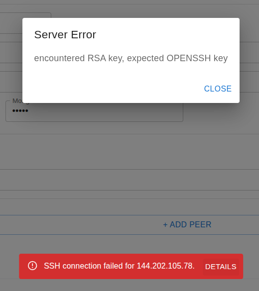
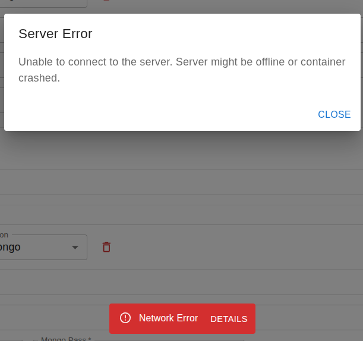

# Errors and troubleshooting

Common errors, what causes them, and how to fix them. Errors are grouped by where they usually show up.

## Contents

* [Check these first](#check-these-first)
* [Reading an error](#reading-an-error)
* [Setup and interface](#setup-and-interface)
* [SSH and remote machines](#ssh-and-remote-machines)
* [Configuration](#configuration)
* [Dashboard](#dashboard)
* [Query](#query)

## Check these first

For any error on this page, check these three before anything else. Most failures that look unrelated come from one of them.

1. **The das-cli version.** The same version has to be installed on the dashboard machine and on every machine in the architecture. Run `das-cli --version` on each one.
2. **The configuration file.** Every machine has to be using the file the dashboard last saved. A machine with an older file, or one edited by hand, does not match what the page shows. Save again from Configuration so each named machine receives the same file.
3. **IPs and ports.** The address of each part has to be reachable, and its port open, from the machines that talk to it. A blocked port looks like a service that never answers.

## Reading an error

Errors appear as a message at the bottom of the screen. Click **DETAILS** when the message has that button. The dashboard puts there the cause it managed to capture, and the message on its own is often only the operation that failed.



Here the message only says the SSH connection to `144.202.105.78` failed. **DETAILS** shows the real problem: the key file is an RSA key, and an OpenSSH key was expected. Save the profile again with the OpenSSH private key.

When das-cli did not answer in the expected format, the details also show the exact command that was run. Run that command in a terminal to see the full output.

A **Network Error** is the case where the page never reached the dashboard at all. **DETAILS** then asks you to check that the server is still running.



Check that the backend container is still up, as described in [Setup and interface](#setup-and-interface).

The dashboard is built to capture an error and show it in **DETAILS** whenever it can. When a message has no details, or the details do not explain it, read the backend container on the dashboard machine:

```bash
docker logs web-interface-backend
```

For a DAS service, read its log on the machine that runs it: `das-cli logs <service>`, for example `das-cli logs query-agent`. `das-cli logs --help` lists the services.

## Setup and interface

**`das-cli not found.`**

The backend container could not find das-cli at `/usr/bin/das-cli`. This happens when das-cli was installed with `pip`. Install it with the APT repository or a `.deb` package, then run `./scripts/start_interface.sh` again. See [Install das-cli and Docker](setup.md#1-install-das-cli-and-docker).

**The page opens, but every action fails with `Network Error`.**

The page could not reach the backend. **DETAILS** says the server might be offline or the container crashed. See the screenshot in [Reading an error](#reading-an-error).

Check the container with `docker ps --filter name=web-interface-backend`. If it is not listed, look at `docker logs web-interface-backend`. A common cause is port `8000` already in use on that machine: start the interface with another port, for example `BACK_PORT=8001 ./scripts/start_interface.sh`.

**`das-cli exited with status … without a formatted JSON response.`**

das-cli failed before it could report the error. The details show the command. Run it in a terminal on that machine. If it works there but not from the dashboard, check that the same das-cli version is installed on every machine.

## SSH and remote machines

**`SSH key is not configured. Set up your profile first.`**

An action needed another machine, and no profile was saved. Save one on the [Profile](using-the-dashboard.md#1-profile) page.

**`SSH authentication failed for <host>.`**

The machine refused the key. Check, in this order:

1. The username on the Profile page is the account that has the key in `~/.ssh/authorized_keys` on that machine.
2. The file you selected on the Profile page is the private key, not the `.pub`.
3. The key works by hand: `ssh -i ~/.ssh/das-dashboard <username>@<host> das-cli --version`.

**`Could not connect to <host>.`**

Nothing answered on that address. The IP is wrong, the machine is off, or port 22 is blocked between the dashboard and that machine.

**`SSH connection failed for <host>.`**

The connection was attempted and failed for another reason, such as a timeout or a key the machine cannot read. Click **DETAILS**. The screenshot in [Reading an error](#reading-an-error) is this message: the host is in the red bar, and the key problem is in the details.

**`Failed to transfer file to <host>.`, or `Configuration file was not found on <host> after transfer.`**

The connection worked, but the file could not be written. The SSH user needs write access to its home directory, where the dashboard creates `~/.das`. Check the free disk space on that machine too.

**Permission denied on the Docker socket.**

The SSH user cannot run Docker on that machine. Add it to the `docker` group, then log out and back in:

```bash
sudo usermod -aG docker <username>
```

## Configuration

**`No servers configured`, or `Configuration file not found`.**

No configuration was saved yet. Open Configuration and click **Save**. See [Keeping the defaults](using-the-dashboard.md#keeping-the-defaults).

**`Configuration must include 'atomdb' and 'agents' sections.`, or `Invalid JSON in configuration file`.**

The file chosen with **Load** is not a DAS configuration, or it is not valid JSON.

**`… cannot be empty when cluster mode is enabled`**

**Redis Cluster** or **Mongo Cluster** is checked, but its list has no rows. Add the members, or uncheck the box, then apply and save. See [Running Redis or MongoDB as a cluster](using-the-dashboard.md#running-redis-or-mongodb-as-a-cluster).

**`Context mapping file not found. Save the context mapping content first.`**

AdapterDB in **Paste content** mode: the mapping was applied before it was saved. Click the **Save** next to Context Mapping, then **Apply AtomDB settings** and **Save** again.

**`Could not find specified section/value from configuration file. … Missing: '<service>'.`**

The action needs a service that the saved configuration does not have. Open that agent on the Configuration page, click **Apply**, then **Save**.

## Dashboard

**`AtomDB must be online before starting architecture.`**

Start the AtomDB first, and wait until its button reads **Stop AtomDB**. See [Starting the DAS](using-the-dashboard.md#starting-the-das).

**`One or more services failed.`**

At least one service in **Start Architecture** or **Stop Architecture** failed. Click **DETAILS**: each failed service has its own line, `Service <name> failed: …`. The usual causes are a port already in use, or Docker not usable by the SSH user. For more, run `das-cli logs <service>` on the machine of that service.

**A server tab shows `Connection failed`, `DAS CLI Error`, `Connection closed`, or `Server connection error`.**

The dashboard could not read that machine's status, which it gets with `das-cli system status`. Check the SSH access to that machine, and that das-cli is installed there in the same version.

**`Failed to start Redis cluster. Please check connectivity between nodes`**

Every Redis member started, but they could not join. Each member must reach the others on the Redis port and on that port plus 10000, the cluster bus port. With the default `40020`, that is `40020` and `50020`.

**`The das-cli metta load command failed.`**

Check that the AtomDB is running. Then look at **DETAILS** for the das-cli output: an error in the file is reported there.

**`Specified server ip is not present on the configuration file.`**

**Metrics collection** was turned on for a server that is not in the saved configuration. Save the configuration that names it, then reload the Dashboard page.

## Query

**`Could not reach the Command Router.`**

The Command Router is not running, or its HTTP API port is not reachable from the dashboard. Start it with **Start Architecture**. If it is already running, check its host on the Configuration page, and that port `40009` is open between the dashboard and that machine.

**`Lost connection to the query stream.`**

The Command Router stopped answering while the query ran. Check that it is still running: `das-cli logs command-router` on its machine.

**The query runs, but no answers arrive.**

Check, in this order:

1. The AtomDB has data. See [Loading a MeTTa file into the AtomDB](using-the-dashboard.md#loading-a-metta-file-into-the-atomdb).
2. **Use MeTTa query** matches the query you typed: on for MeTTa, off for DAS query tokens.
3. **Only answers with non-zero STI** is off. Right after loading, no atom has importance yet.
4. **Limit the number of answers** is not set lower than you expect.

**`Public key file must contain a single non-empty token or one valid SSH public key.`**

The key file is empty, has more than one line, or is not a valid public key. Choose the `.pub` file.

**`atomdb.uid must be a single non-empty token to use a public key.`**

A key was chosen, but the saved configuration has no AtomDB `uid`. Remove the key to query an AtomDB that is not protected.
