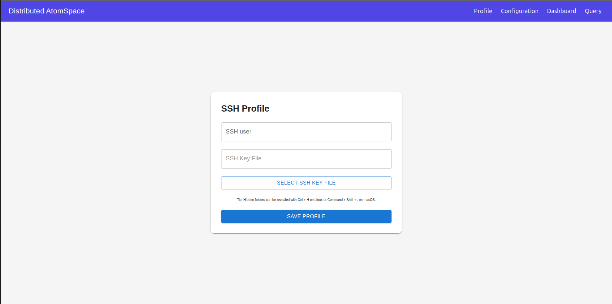
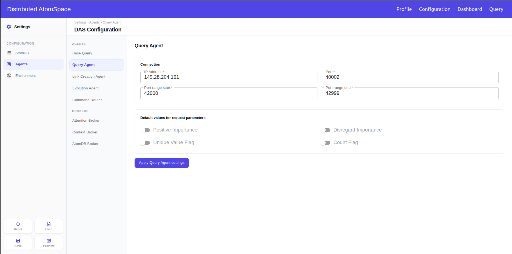
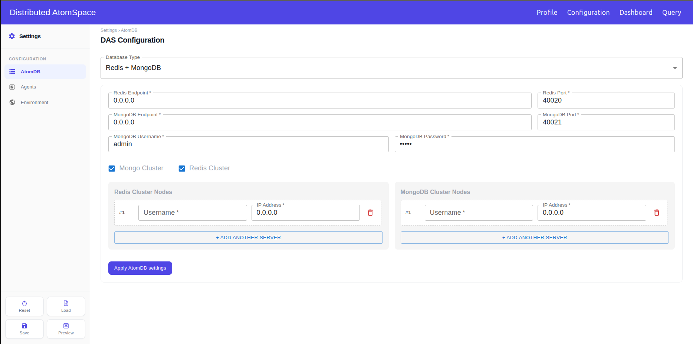
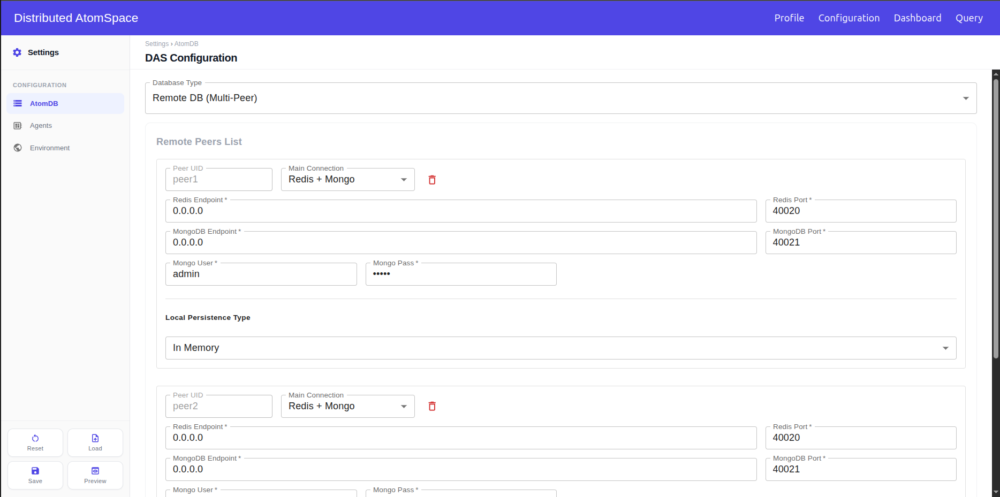
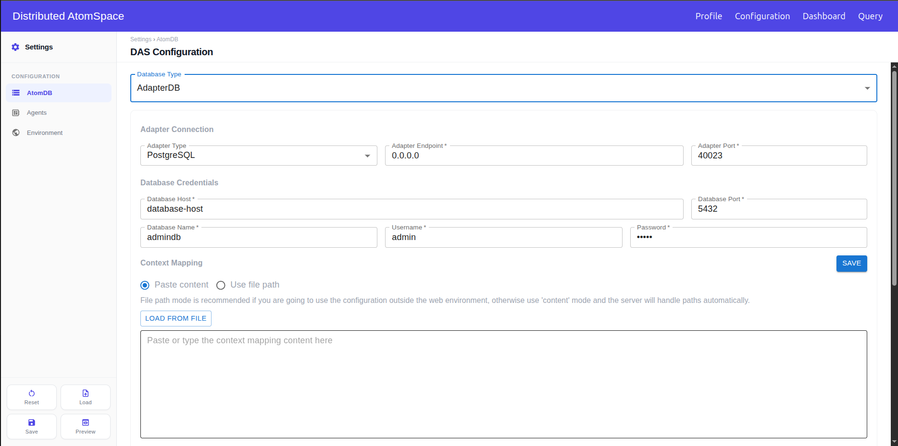
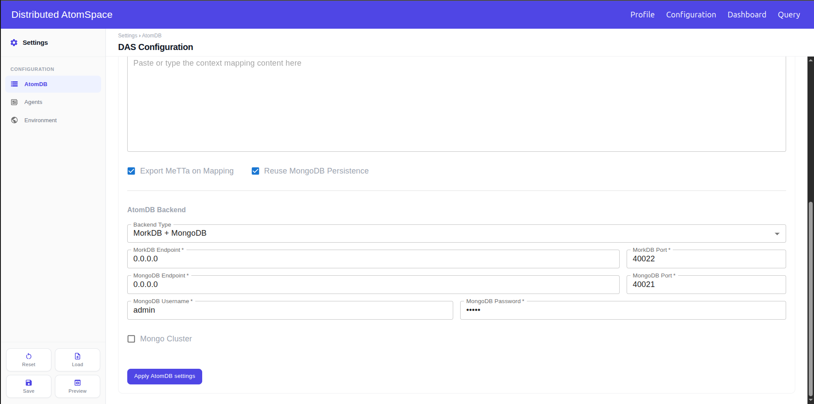
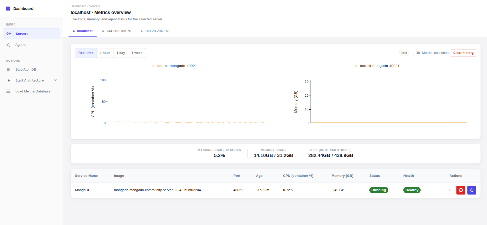
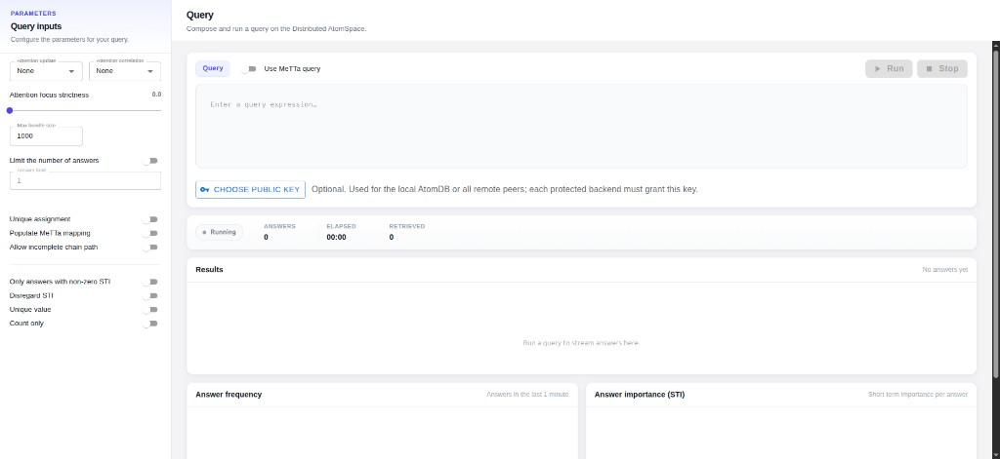

# Using the dashboard

A first run goes in this order: save your SSH profile, save a configuration, start the DAS on the Dashboard page, and run queries on the Query page.

If the whole DAS runs on this machine with the default values, skip Profile. Open Configuration and click **Save**.

This guide assumes the dashboard is already running. See [Setting up the environment](setup.md). For every field, button, and default value, see the [Reference](reference.md).

## Contents

* [1. Profile](#1-profile)
  * [Setting up a profile](#setting-up-a-profile)
* [2. Configuration](#2-configuration)
  * [Keeping the defaults](#keeping-the-defaults)
  * [Changing a few parameters and values](#changing-a-few-parameters-and-values)
  * [Running the DAS on more than one machine](#running-the-das-on-more-than-one-machine)
  * [Running Redis or MongoDB as a cluster](#running-redis-or-mongodb-as-a-cluster)
  * [Using another AtomDB](#using-another-atomdb)
  * [Loading a configuration you already have](#loading-a-configuration-you-already-have)
  * [Checking before you save](#checking-before-you-save)
  * [Starting over](#starting-over)
* [3. Dashboard](#3-dashboard)
  * [Starting the DAS](#starting-the-das)
  * [Loading a MeTTa file into the AtomDB](#loading-a-metta-file-into-the-atomdb)
  * [Watching one service](#watching-one-service)
  * [Keeping a metrics history](#keeping-a-metrics-history)
  * [Seeing the whole architecture](#seeing-the-whole-architecture)
  * [Stopping the DAS](#stopping-the-das)
* [4. Query](#4-query)
  * [Running a query](#running-a-query)
  * [Changing the parameters for one query](#changing-the-parameters-for-one-query)
  * [Querying a protected AtomDB](#querying-a-protected-atomdb)
* [Errors and troubleshooting](troubleshooting.md)

## 1. Profile



Do this first when the DAS will use more than one machine. The dashboard reaches every other machine with this user and key.

### Setting up a profile.

1. Create the key pair and authorize it on every machine, as described in [SSH access](setup.md#2-set-up-ssh-access).
2. Open **Profile** and type the SSH user. It cannot be `root`.
3. Click **Select SSH Key File** and pick the private key, the file without `.pub`.
4. Click **Save Profile**.

When you come back to change something, select the key again: the page keeps the username but not the key. If a later step fails with an authentication error, the public key is not authorized for that user on that machine.

## 2. Configuration

This page sets up the DAS environment and its agents. Changing anything here is optional: with the default values, one **Save** is enough.

The sidebar splits the configuration into **AtomDB**, **Agents**, and **Environment**. Every change follows the same steps: change the fields, click **Apply … settings** at the bottom of that section, then click **Save**. Apply alone stores nothing, and Save only stores what was applied.

### Keeping the defaults

If the default values are enough, click **Save**. The defaults put the whole DAS on this machine. The dashboard stores the configuration and sets it as the current DAS configuration. If the file names another machine, Save also copies it there and runs `das-cli config set` on that machine. That copy needs the SSH user and key from [Profile](#1-profile).

After a successful save, the page asks **Save a local copy?**. Downloading that copy is optional. **Not now** leaves the file on the server at `/opt/web-das/.das/config.json`.

### Changing a few parameters and values

To change a port, an ip address or a parameter in general:

1. Open the section in the sidebar. For an agent, open **Agents** and pick it from the list.
2. Change the fields specified on the sub-section.
3. Click **Apply … settings**. The page confirms that the settings were applied.
4. Repeat for any other section you want to change.
5. Click **Save**.

If you move to another section without clicking Apply, the edits you made there are not in the file.

### Running the DAS on more than one machine

The addresses on this page are not only where the dashboard starts each part. The DAS reads them back, and that is how its parts find each other. The Link Creation Agent, the Evolution Agent, and the Context Broker look for the Query Agent at its address. The agents look for the Attention Broker at its address. The members of a database cluster reach each other at theirs.

So type addresses with that in mind. The default `0.0.0.0` only works when everything is on one machine. For anything that runs on another machine, type the IP the other machines use to reach it.



1. Save your [Profile](#1-profile), and authorize the key on every machine.
2. Decide which machine runs each part, and note the IP each machine is reached at.
3. Open **AtomDB** and type the IP of the database machine in the endpoint fields. Click **Apply AtomDB settings**.
4. Open **Agents**. For each agent on another machine, type that machine's IP and click **Apply**. Do the Query Agent and the Attention Broker first: the other agents look for them.
5. Click **Save**. The dashboard copies the file to every machine named in it and makes it the active configuration there. The confirmation lists the machines it reached.

Then open the Dashboard page to start each part on its machine.

**Example: two machines.**

| Machine | IP | Runs |
|---|---|---|
| A | `144.56.128.58` | AtomDB, Attention Broker, Query Agent |
| B | `151.124.20.2` | Link Creation Agent, Evolution Agent |

On the Configuration page:

* **AtomDB**: Redis Endpoint and MongoDB Endpoint set to `144.56.128.58`.
* **Attention Broker** and **Query Agent**: IP Address set to `144.56.128.58`.
* **Link Creation Agent** and **Evolution Agent**: IP Address set to `151.124.20.2`.

In this example, suppose that the dashboard runs on Machine A. The agents not listed keep their default address, so they run on A as well.

After **Save**, both machines have the same file. **Start Architecture** starts the Attention Broker and the Query Agent on A, and the Link Creation Agent and the Evolution Agent on B. When the agents on B start, they read the file, find the Query Agent at `144.56.128.58`, and connect to it there. Machine B must be able to reach Machine A on the Query Agent and Attention Broker ports.

### Running Redis or MongoDB as a cluster

Cluster mode is optional. Use it when Redis or MongoDB should run on several machines and work as one database.



1. Save your [Profile](#1-profile). Every member of the cluster is started over SSH with it.
2. Open **AtomDB** and choose **Redis + MongoDB**. Mork + MongoDB works too, but only MongoDB can be a cluster there.
3. Check **Redis Cluster**, **Mongo Cluster**, or both.
4. In the list that opens, fill one row per machine: the IP of the machine that will run that member, and the username saved in Profile. Click **+ Add Another Server** for each extra machine. das-cli expects at least three members.
5. Make sure the port above the list is free on all of those machines. Every member listens on it.
6. Click **Apply AtomDB settings**, then **Save**.

When the AtomDB is started, das-cli connects to each row over SSH, starts the database there, and joins the members into one cluster. The machines need to reach each other on that port.

### Using another AtomDB

A DAS uses one AtomDB type. Redis + MongoDB is the default. To use another one, choose it in **Database Type**, fill it in, and click **Apply AtomDB settings**. The new type replaces the old one. Then click **Save**.

**Mork + MongoDB.** Same steps as Redis + MongoDB, with MorkDB in place of Redis.

**In Memory.** Nothing to fill in and no database to start. Choose it, apply, and save. The atoms live only in memory, so they are gone when the process stops.

**Remote DB.** A set of peers, each with its own database. The form opens with two peers, `peer1` and `peer2`. Remove any peer you do not need.



1. Click **+ Add Peer** for each extra peer.
2. For each peer, choose the **Main Connection** and fill its addresses and ports.
3. Choose the **Local Persistence Type** for each peer. In Memory needs nothing else.
4. Click **Apply AtomDB settings**. A peer with an empty port is left out.

**Start AtomDB** starts Redis and MongoDB only for peers whose main connection is Redis + Mongo. A Mork + Mongo peer is not started by that button. Start that database on its own machine.

**AdapterDB.** Maps an external PostgreSQL database into atoms. In here you have to set-up both the DB that will be used to load the atoms, and the AtomDB that will persist the atoms.



1. Under **Adapter Connection**, set where the adapter will listen.
2. Under **Database Credentials**, type the PostgreSQL database to map.
3. Under **Context Mapping**, keep **Paste content**. Paste the mapping, or click **Load from file** and pick the `.sql` file. Click the **Save** next to Context Mapping.
4. Scroll down to **AtomDB Backend** and choose where the mapped atoms will be stored. Fill it in the same way as that AtomDB type.
5. Click **Apply AtomDB settings**, then **Save**.



Choose **Use file path** in step 3 only if the configuration will also be used outside the dashboard. Then type the path of the mapping file instead.

### Loading a configuration you already have

1. Click **Load** and pick the `.json` file.
2. Confirm. The file replaces the configuration on this dashboard, and the form shows its values.
3. To change something, edit the section, click **Apply**, then **Save**.

Load only changes this dashboard. If the file names other machines, click **Save** after loading to copy it to them.

### Checking before you save

Click **Preview** to see what Save will store. If a change you made is missing, go back to that section and click **Apply**.

### Starting over

Click **Reset** and confirm. Every section goes back to the DAS defaults, and what you typed is lost. The file already saved stays as it is until you click **Save** again.

## 3. Dashboard

This is where you start the DAS and watch it run. The page reads the saved configuration and connects to every machine named in it.



It has two views, picked in the sidebar. **Servers** shows one machine at a time, and the tabs at the top switch between machines. `localhost` is this machine. **Agents** shows every service on every machine at once. The actions under the views start and load the DAS.

If the page says **No servers configured**, save a configuration first. See [Keeping the defaults](#keeping-the-defaults).

### Starting the DAS

The AtomDB comes first: the agents need it to run.

1. In **Servers**, select the tab of the machine that hosts the AtomDB. **Start AtomDB** runs on the selected server.
2. Click **Start AtomDB** and confirm. Redis, MongoDB, and MorkDB containers already running there are kept.
3. Wait until the button reads **Stop AtomDB**. **Start Architecture** stays disabled until then.
4. To start only some services, click the arrow next to **Start Architecture** and uncheck the ones you don't need. Leave **Core** checked: the Attention Broker and the Query Agent are what the other agents connect to. With a Remote DB, only those two and the Command Router start checked.
5. Click **Start Architecture** and confirm the list. Each service starts on the machine set for it in Configuration.
6. Check the table on each server tab. A started service shows **Running**.

### Loading a MeTTa file into the AtomDB

1. In **Servers**, select the tab of the machine that hosts the AtomDB. The file is sent to the selected server.
2. Click **Load MeTTa Database** and pick the file. Only `.metta` files are accepted.
3. Wait for the confirmation. The file is copied to that server, or kept on the dashboard when the selected server is `localhost`, and loaded into the AtomDB.

If a file with that name was already sent, the page asks what to do. **OK** replaces it with the new one. **Cancel** loads the file already there.

### Watching one service

In the table under the charts, click the service. The CPU and memory charts now show only that service. Click it again to go back to all of them.

To start, stop, or restart that one service, use the buttons at the end of its row.

### Keeping a metrics history

The charts open in **Real-time**, which needs nothing else. To look back over an hour, a day, or a week, the dashboard has to record samples first.

1. Select the server tab.
2. Turn on **Metrics collection**. The chip next to it changes from **Idle** to **Collecting**.
3. Later, pick **1 hour**, **1 day**, or **1 week** above the charts.

Collection keeps running for that server while the dashboard is up, even with the page closed. Turn it off with the same switch. **Clear history** deletes what was recorded.

### Seeing the whole architecture

Click **Agents** in the sidebar. Every service on every machine appears as a card, with the agents and the AtomDB on separate tabs. Click a card to open its live CPU and memory charts.

### Stopping the DAS

1. Click the arrow next to **Stop Architecture** if you want to keep some services running, and uncheck them.
2. Click **Stop Architecture** and confirm.
3. Select a server tab and click **Stop AtomDB**. Confirm.

   With Redis + MongoDB or Mork + MongoDB on one machine, select that machine. The databases there stop. Redis keeps nothing on disk, so its data is gone when it stops.

   With Redis Cluster or Mongo Cluster, select `localhost`. **Stop AtomDB** there walks every cluster node and stops it through its Docker context. It does not stop only the selected machine.

   With a Remote DB, **Stop AtomDB** stops Redis and MongoDB for every Redis + Mongo peer, on each peer's own machine, whichever server tab is selected. Save copies the configuration with an empty Docker context, and `config set` on each machine creates those contexts there. The stop command then walks every Redis + Mongo peer. A Mork peer is left running. No tab stops only one peer.

## 4. Query



This page sends queries to the Query Agent and shows the answers while they arrive. The query parameters are on the left. The query box, the results, and two charts are on the right.

Before the first query:

* The Query Agent and the Command Router must be running. The page reaches the Query Agent through the Command Router. **Start Architecture** with the default selection starts both, together with the Attention Broker the Query Agent uses. See [Starting the DAS](#starting-the-das).
* The AtomDB must have data. See [Loading a MeTTa file into the AtomDB](#loading-a-metta-file-into-the-atomdb).

### Running a query

1. Open **Query**.
2. Turn on **Use MeTTa query** to write the query in MeTTa. Leave it off to write it as DAS query tokens.
3. Type the query.
4. Click **Run**.

Answers appear under **Results** as they arrive, and the counters and charts update with them. **Stop** ends the query before it finishes.

The same query in both forms:

```
(Similarity "human" $S)
```

```
LINK_TEMPLATE Expression 3 NODE Symbol Similarity NODE Symbol "human" VARIABLE S
```

Results shows the last 10 answers. Click **Show all results** to page through all of them.

### Changing the parameters for one query

The parameters open with the values saved in the configuration, under Base Query and Query Agent. If the configuration has none, they open with the DAS defaults.

1. Change the parameters on the left.
2. Type the query and click **Run**.

The query runs with the values on the screen. They are not saved: reloading the page brings back the configured values. To change them for good, edit Base Query or Query Agent on the Configuration page. See [Changing a few parameters and values](#changing-a-few-parameters-and-values).

To get only the number of answers, turn on **Count only**. Results then shows a single line with the total.

### Querying a protected AtomDB

1. Click **Choose public key** and pick your `.pub` file.
2. Type the query and click **Run**.

The key is sent with the query, for the AtomDB or, with Remote DB, for every peer. Each protected database must grant access to that key. The × next to the file name removes it.

## When something fails

See [Errors and troubleshooting](troubleshooting.md).
